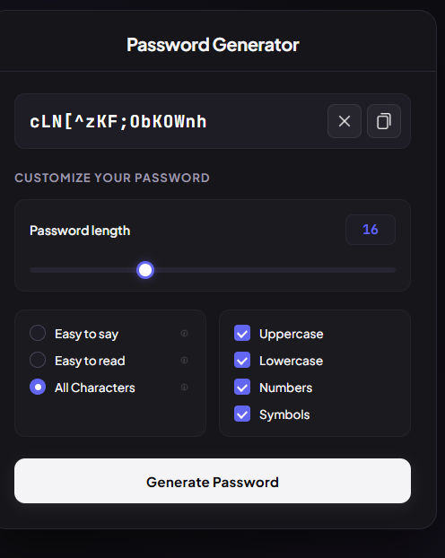

#  Modern Password Generator

A sleek, dark-mode Password Generator web application designed to generate strong, secure, and customizable passwords instantly with one-click clipboard support.

---

## 📸 Preview



---

##  Features

- **Custom Length Slider:** Easily adjust password length from short to high-entropy lengths.
- **Rules Selection:**
  - **Easy to say:** Avoids complex symbols/numbers for pronounceable passwords.
  - **Easy to read:** Excludes ambiguous characters (like `O`, `0`, `l`, `1`).
  - **All Characters:** Full entropy using mixed character sets.
- **Granular Character Types:**
  - Uppercase letters (`A-Z`)
  - Lowercase letters (`a-z`)
  - Numbers (`0-9`)
  - Special Symbols (`!@#$%^&*...`)
- **One-Click Copy:** Quick copy to clipboard with instant feedback.
- **Responsive Dark UI:** Clean, modern, eye-friendly dark design.

---

##  Tech Stack

- **HTML5:** Semantic markup & structure
- **CSS3:** Custom responsive layout & dark-mode styling
- **JavaScript (ES6):** Password generation logic & DOM manipulation

---

##  Getting Started

### 1. Clone the repository
```bash
git clone [https://github.com/Imama1076/modern-password-generator.git](https://github.com/Imama1076/modern-password-generator.git)
